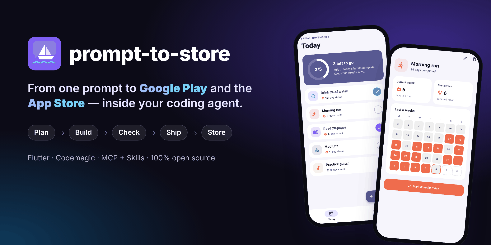
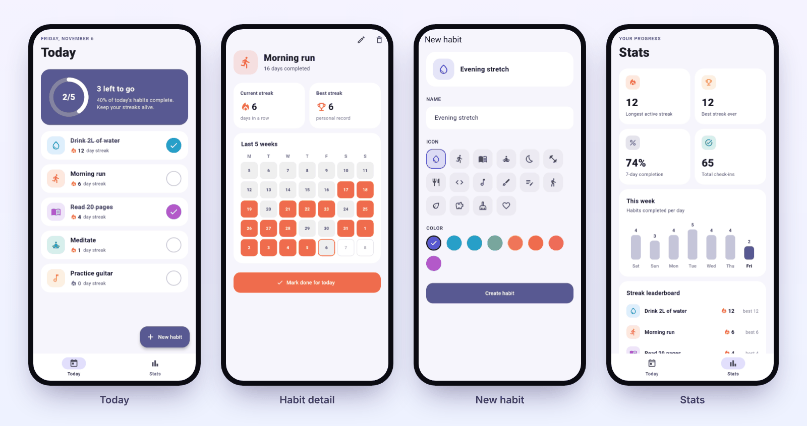
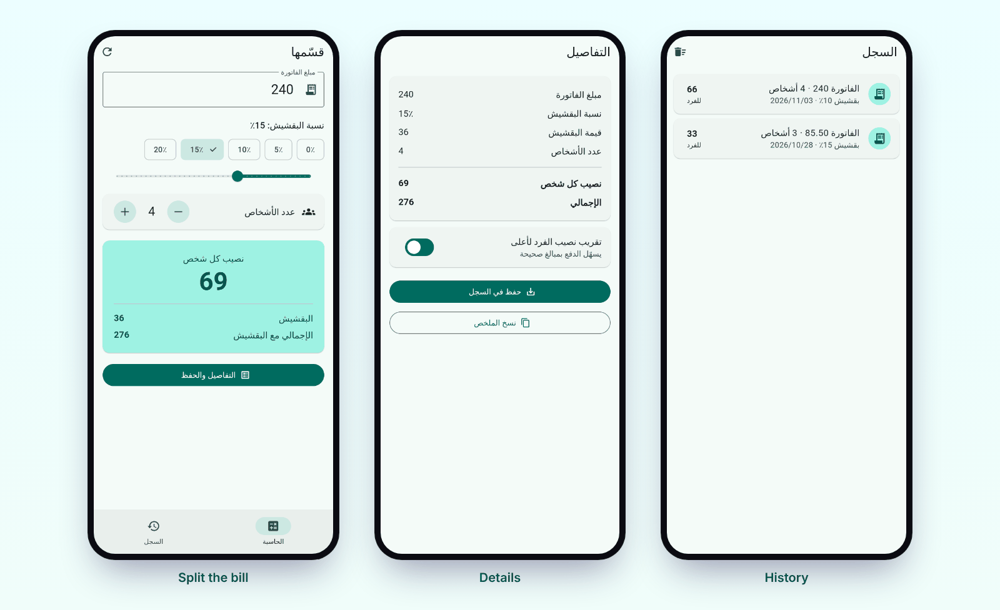
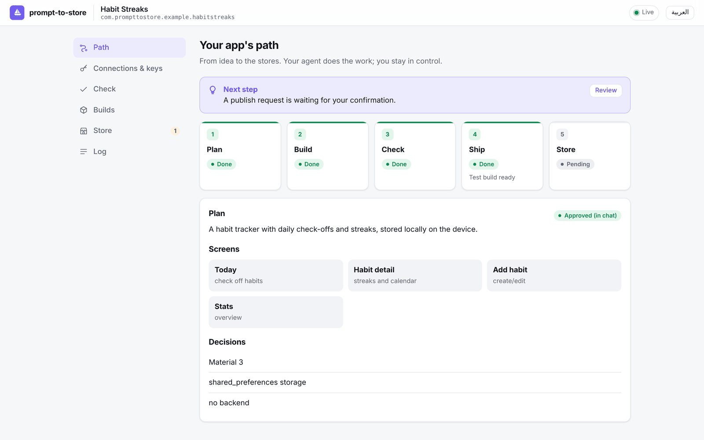
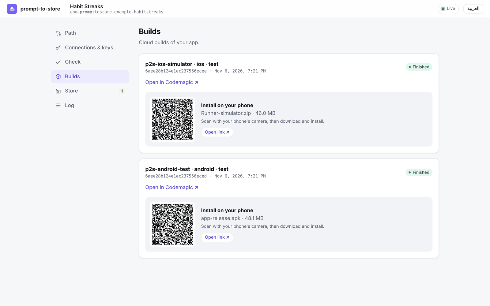
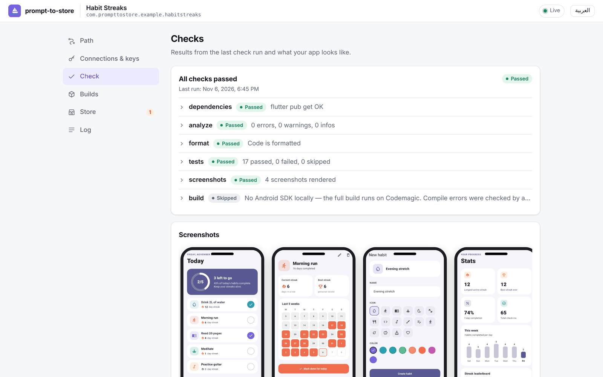
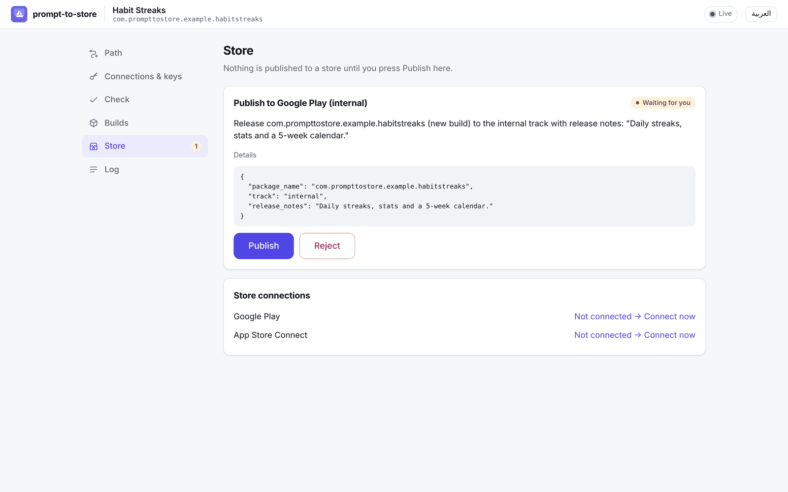

<div align="center">


# prompt-to-store

**من طلب واحد إلى Google Play وApp Store — داخل وكيلك البرمجي.**

خطّط وابنِ واختبر وانشر تطبيق Flutter حقيقيًا بالحديث مع Claude Code أو Codex أو Cursor.<br>
كودك وحساباتك ملكك، بلا اشتراك، ومفاتيحك لا تمر بالمحادثة أبدًا.

[](https://github.com/taymaapp/prompt2store/actions/workflows/ci.yml)
[](LICENSE)
[](https://flutter.dev)

[English](README.md)

<br>



</div>

<div dir="rtl">

## ✨ لماذا؟

الوكلاء البرمجيون يكتبون التطبيق في ساعة، لكن وصوله **إلى الهاتف** ثم **إلى المتاجر** ما زال يأخذ أيامًا: أدوات تطوير، ومفاتيح توقيع، وشهادات، وخطوط بناء، ولوحات تحكم المتاجر، ولقطات شاشة، ورفض.

**prompt-to-store** يسد هذه الفجوة. يضاف إلى وكيلك الذي تستخدمه أصلًا كخادم MCP مع مجموعة مهارات، ومعه صفحة ويب محلية صغيرة تبقى فيها **أنت** المتحكم.

- 🧑‍💻 **لا تحتاج خبرة تقنية:** الوكيل يثبت Flutter إن لم يكن موجودًا، ويكتب التطبيق، ويختبره، ويبنيه في السحابة. لن تفتح الطرفية أبدًا.
- 🔑 **كودك وحساباتك ملكك:**
  - الكود في مجلدك وعلى GitHub الخاص بك.
  - البناء على حسابك في Codemagic، وفيه 500 دقيقة مجانية شهريًا.
  - المشروع مشروع Flutter عادي مع ملف `codemagic.yaml` مقروء، فلا تبقى مرتبطًا بنا.
- 🛡️ **الوكيل لا يرى أي مفتاح:** تدخل المفاتيح في صفحة على جهازك، وتُحفظ في سلسلة مفاتيح النظام أو في ملف خاص.
- 🚦 **بوابات لا وعود:** لا إرسال قبل نجاح الفحص، ولا نشر دون ضغطة صريحة منك.

## 🚀 البدء السريع

</div>

```bash
npx prompt-to-store setup
```

<div dir="rtl">

يكتشف وكلاءك، ويعرض ما سيغيره بالضبط، ويسألك قبل أي تغيير، ويأخذ نسخة احتياطية من كل ملف. بعدها أعد تشغيل وكيلك واطلب:

</div>

```text
ابنِ لي تطبيقًا لتتبع العادات مع سلاسل الأيام، وأرسل لي نسخة تجريبية.
```

<div dir="rtl">

وعندما تكون جاهزًا للمتجر: «انشره على مسار الاختبار الداخلي في Google Play».

## 🧭 كيف يعمل

| المرحلة | ما يحدث | البوابة |
|---|---|---|
| **١ · الخطة** | الوكيل يقترح الشاشات والقرارات، وأنت توافق في المحادثة أو بضغطة | — |
| **٢ · البناء** | الوكيل يكتب تطبيق Flutter حقيقيًا (Material 3، فاتح وداكن، مع اختبارات) | الموافقة على الخطة |
| **٣ · الفحص** | تحليل الكود والاختبارات، و**لقطة لكل شاشة** دون محاكي | وجود مشروع Flutter |
| **٤ · الإرسال** | رفع الكود ثم البناء على Codemagic، ثم رابط تثبيت ورمز QR | نجاح الفحص وربط Codemagic |
| **٥ · المتجر** | بيانات المتجر والصور والإصدار على Google Play وTestFlight وApp Store | بناء ناجح + **ضغطتك** |

### فحص بلا محاكي

ترسم أداة `check_run` كل شاشة كصورة 1290×2796 بخطوط حقيقية. الوكيل ينظر إلى الصور ويصلح مشاكل التصميم قبل الإرسال، ونفس الصور صالحة للمتاجر.

</div>



<div dir="rtl">

### أي لغة، ومنها العربية من اليمين لليسار

بنى وكيل هذا التطبيق وحده في نحو أربع دقائق ونصف، من جملة واحدة بالعربية. أصلح فحصين فاشلين بنفسه، ثم توقف عند بوابة Codemagic ليطلب المفتاح.

</div>



<div dir="rtl">

## 🖥️ الواجهة المحلية

صفحة على جهازك، بلا محادثة، ولا تشغّل الوكيل. تريك ما يحدث وتطلب مدخلاتك عند الحاجة، بالعربية والإنجليزية، فاتحة وداكنة.

</div>

<table>
  <tr>
    <td width="50%"></td>
    <td width="50%"></td>
  </tr>
  <tr>
    <td></td>
    <td></td>
  </tr>
</table>

<div dir="rtl">

## 🛡️ الأمان

- المفاتيح تُدخل في صفحة على `127.0.0.1`، محمية برمز خاص بالمشروع.
- الوكيل ممنوع من قراءة ملف المفاتيح، ومخرجات الأدوات تُنقّح.
- النشر لا يتم إلا بضغطة منك في الواجهة.
- مفاتيح التوقيع تُولَّد على جهازك وتبقى في حسابك أنت.

## 🗺️ الحالة

**الإصدار 0.1، نسخة معاينة لم تُنشر بعد على npm.**

- **ما تم التحقق منه:**
  - 213 اختبارًا آليًا.
  - بناء حقيقي على Codemagic لأندرويد وiOS.
  - تجربة وكيل حقيقي من مجلد فارغ.
- **ما لم يُجرَّب بعد مع الحسابات الحقيقية:**
  - أدوات Google Play وApp Store، ومعها توقيع الإصدارات.
  - التشغيل على macOS Keychain وWindows.

المقارنة الكاملة مع Expo وFlutterFlow وغيرهما في [docs/COMPARISON.md](docs/COMPARISON.md). الترخيص: [MIT](LICENSE).

</div>
