<div align="center">


# prompt-to-store

**From one prompt to Google Play and the App Store — inside your coding agent.**

An open-source **plugin for coding agents** (MCP server + skills + a local companion UI).<br>
Plan, build, test and ship a real Flutter app by talking to your agent. Your code, your accounts, no subscription.

[](https://github.com/taymaapp/prompt2store/actions/workflows/ci.yml)
[](LICENSE)
[](package.json)
[](https://modelcontextprotocol.io)
[](https://flutter.dev)

**Works with** Claude Code · Codex · Cursor · Gemini CLI · Windsurf <sub>(end-to-end tested on Claude Code; the others are configured by `setup`)</sub>

[Quick start](#-quick-start) · [How it works](#-how-it-works) · [Screenshots](#-the-companion-ui) · [Tools](#-tools) · [Security](#-security) · [FAQ](#-faq) · [العربية](README.ar.md)

<br>

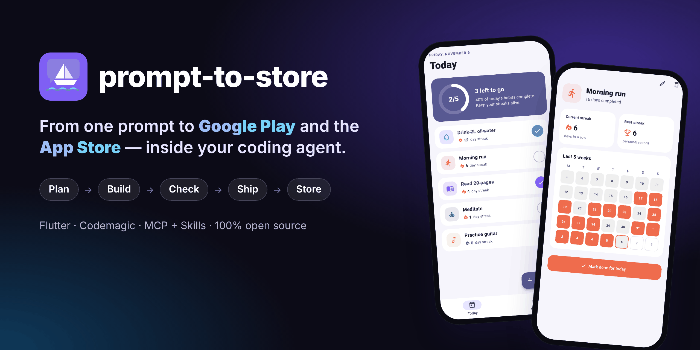

</div>

## 🎬 See it work: 48 seconds, one real run

<a href="docs/assets/demo.mp4">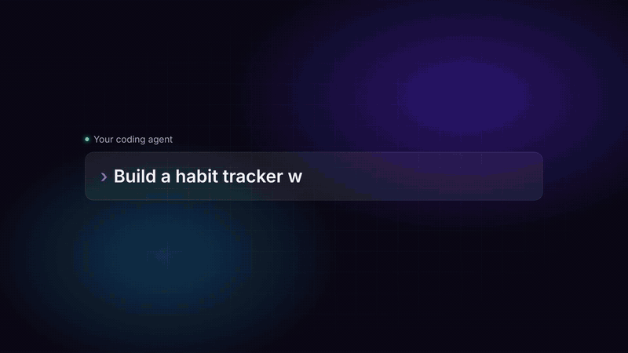</a>

<sub>Nothing in this demo is staged:
<ul>
<li>A coding agent built the app from the single sentence shown.</li>
<li>The checks and screenshots ran headlessly.</li>
<li>Codemagic built the APK on a real account.</li>
<li>The QR code is the real install link.</li>
</ul>
Time: about 3 minutes of agent work plus a 7.8-minute cloud build. ▶ <a href="docs/assets/demo.mp4">Full video with sound</a> · <a href="docs/assets/demo-vertical.mp4">vertical version</a></sub>

---

## ✨ Why

Coding agents can write an app in an hour. Getting it **onto a phone** and **into the stores** still takes days: SDKs, signing keys, certificates, CI, store consoles, screenshots, rejections.

**prompt-to-store** closes that gap. It plugs into the agent you already use as an MCP server plus a set of skills, and it adds a small local web page where *you* stay in control.

```text
You:   Build a habit tracker with daily streaks and send me a test build.

Agent: Here's the plan: 4 screens, local storage, no backend. OK?           ← Plan
       ✓ Wrote the app · ✓ 17 tests pass · ✓ Rendered 4 screenshots          ← Build · Check
       Connect Codemagic here (your key stays on your computer): localhost…  ← one-time setup
       ✓ Built on Codemagic. Scan the QR code to install it on your phone.    ← Ship
```

- 🧑‍💻 **No experience needed.** The agent installs Flutter if it's missing, writes the app, tests it and builds it in the cloud. You never open a terminal.
- 🔑 **Your code, your accounts.** Code lives in your folder and your GitHub. Builds run on *your* [Codemagic](https://codemagic.io) account (500 free macOS minutes a month). Everything is a plain Flutter project and a readable `codemagic.yaml`, so there's no lock-in.
- 🛡️ **The agent never sees a key.** You enter keys on a `localhost` page. They're stored in your OS keychain or a private file, and the agent only ever gets a link.
- 🚦 **Gates, not hope.** Every tool checks the pipeline order: no shipping before checks pass, no publishing without your explicit click.

## 🚀 Quick start

**1. Install** (once). It detects your agents, shows exactly what will change, asks first and backs up every file it touches:

```bash
npx prompt-to-store setup
```

**2. Restart your agent and ask for an app:**

```text
Build a habit tracker with daily streaks and send me a test build.
```

**3. When you're ready for the stores:**

```text
Publish it to Google Play internal testing.
```

<details>
<summary><b>Other ways to install</b></summary>

**Claude Code plugin**
```text
/plugin marketplace add taymaapp/prompt2store
/plugin install prompt-to-store@prompt-to-store
```

**Manual MCP config** (any MCP client)
```json
{ "mcpServers": { "prompt-to-store": { "command": "npx", "args": ["-y", "prompt-to-store@latest", "mcp"] } } }
```

`setup` flags: `--dry-run` · `--yes` · `--agents claude,cursor,codex,gemini,windsurf` · `--uninstall`
</details>

**What you need:** Node.js 20+ and a coding agent. A free [Codemagic](https://codemagic.io) account for cloud builds. Store accounts only when you publish: [Google Play Console](https://play.google.com/console) and/or the [Apple Developer Program](https://developer.apple.com/programs/).

## 🧭 How it works

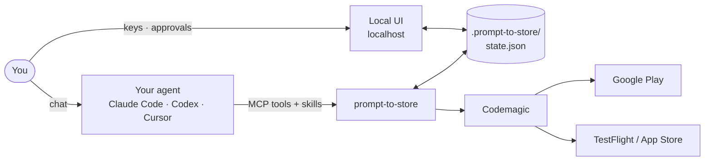

| Stage | What happens | Gate |
|---|---|---|
| **1 · Plan** | The agent proposes screens and decisions; you approve in chat or with one click | — |
| **2 · Build** | The agent writes a real Flutter app (Material 3, light/dark, tests) | Plan approved |
| **3 · Check** | Analyzer, tests, and **a screenshot of every screen** rendered headlessly | Flutter project exists |
| **4 · Ship** | Code is committed and pushed, then built on Codemagic. You get an install link and a QR code | Check passed + Codemagic connected |
| **5 · Store** | Listing, screenshots and release on Google Play / TestFlight / App Store | Successful build + **your click** |

### Check without an emulator

`check_run` renders every screen to a **1290×2796 PNG with real fonts**. It needs no emulator or device, and the agent looks at the images and fixes layout bugs before shipping. The same images are valid App Store and Google Play screenshots.

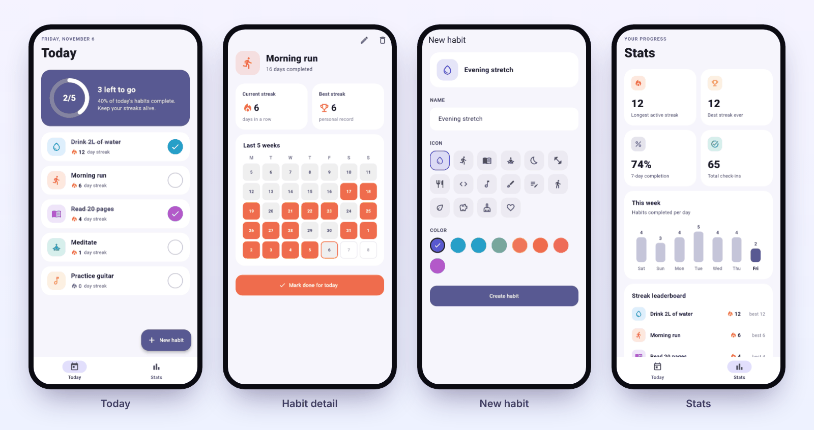

<sub>The <a href="examples/habit_streaks">Habit Streaks example</a>. Every screenshot above was produced by <code>check_run</code>, headless.</sub>

### Any language, right-to-left included

An agent built the app below on its own, in about 4.5 minutes, from a single sentence written in Arabic. It fixed two failing checks along the way and then stopped at the Codemagic gate to ask for the key.

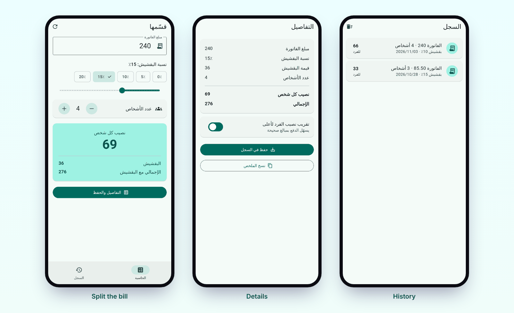

### Built with prompt-to-store

| App | Prompt | Result |
|---|---|---|
| [Habit Streaks](examples/habit_streaks) | *"Build a habit tracker with daily streaks and send me a test build."* | 4 screens, 17 tests, Android APK + iOS simulator build on Codemagic |
| Qassimha (bill splitter, Arabic) | *A one-line request written in Arabic* | RTL app, 7 tests, 5 screenshots: built by an agent unattended in ~4.5 minutes |

<sub>Built something? Open a PR to add it here.</sub>

## 🖥️ The companion UI

A local page (`npx prompt-to-store ui`, or the link your agent gives you). It has no chat and never runs the agent. It shows you what is happening and asks for your input when it's needed. It comes in English and Arabic, light and dark.

<table>
  <tr>
    <td width="50%">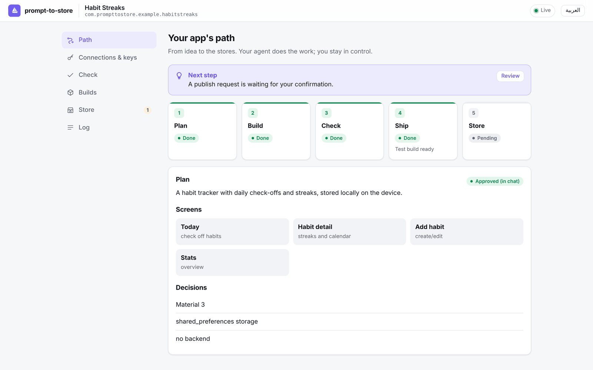<br><b>Path</b>: every stage, live, plus the next step and the approved plan.</td>
    <td width="50%">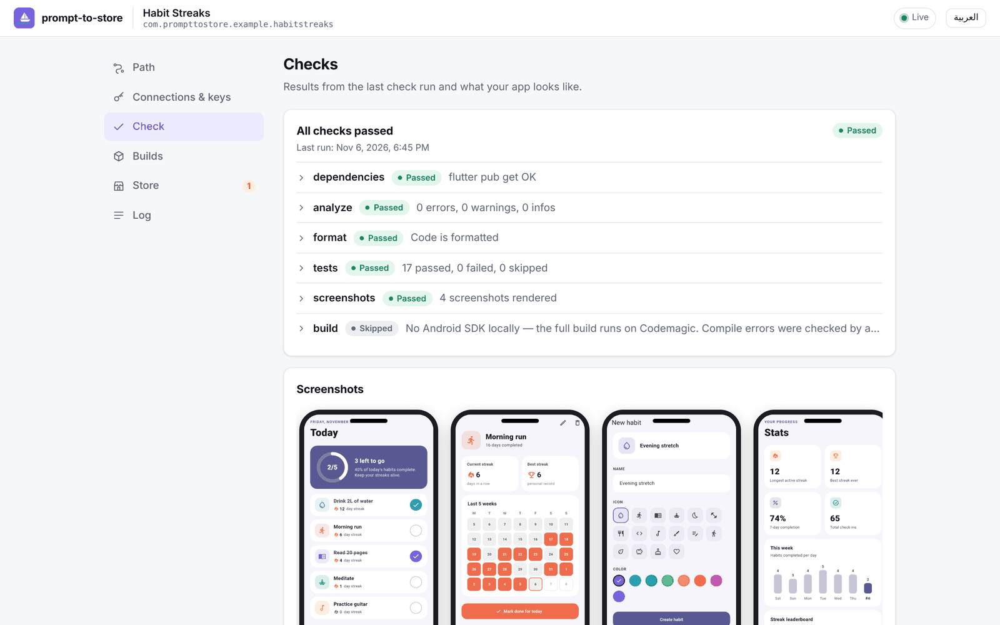<br><b>Check</b>: analyzer, tests and the rendered screenshots.</td>
  </tr>
  <tr>
    <td>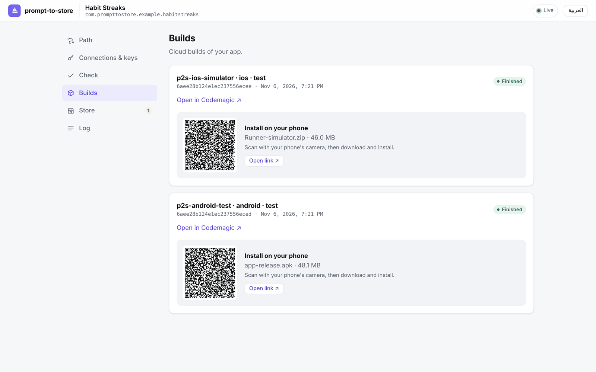<br><b>Builds</b>: Codemagic builds with an install link and a QR code.</td>
    <td>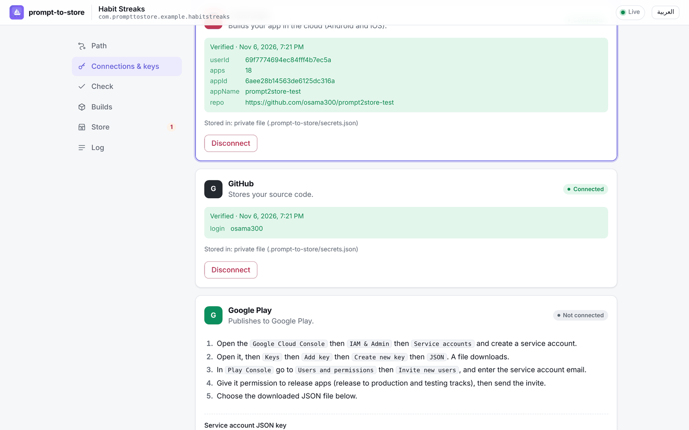<br><b>Connections &amp; keys</b>: step-by-step guides, instant verification.</td>
  </tr>
  <tr>
    <td>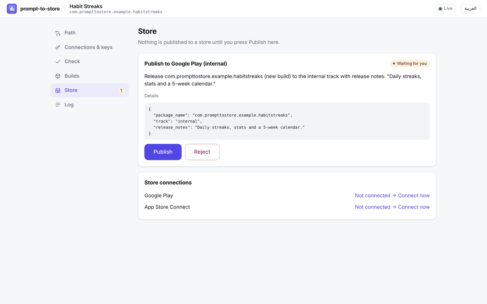<br><b>Store</b>: nothing is published until you press Publish.</td>
    <td>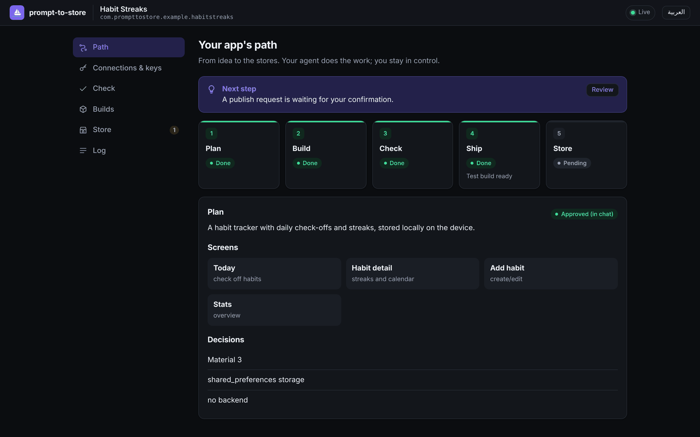<br><b>Dark mode</b>, plus a full Arabic (RTL) interface.</td>
  </tr>
</table>

## 🧰 Tools

28 MCP tools. If a tool is called out of order, it returns `{ "blocked": true, "reason": …, "next_step": … }`, so the agent always knows what to do next. Tools that change something accept `dry_run: true`.

| Group | Tools |
|---|---|
| **State** | `state_get` · `plan_save` · `stage_update` · `setup_link` |
| **Environment** | `env_check` (installs Flutter on request) · `app_create` (project with the exact store ids) · `font_add` (bundled Arabic font) |
| **Check** | `check_run` · `check_results` |
| **Codemagic** | `cm_connect_status` · `ship_test_build` · `ship_release_build` · `build_status` · `build_logs` · `build_cancel` |
| **Google Play** | `play_listing_get` · `play_listing_update` · `play_screenshots_upload` · `play_track_status` · `play_publish` · `play_reviews` · `play_reply` |
| **App Store** | `asc_metadata_get` · `asc_metadata_update` · `asc_screenshots_upload` · `asc_testflight_status` · `asc_submit_review` · `asc_reviews` |

**Skills** teach the agent the process:
- `prompt-to-store`: the pipeline, and when to stop and ask
- `check`
- `ship`
- `store-listing`: per-store limits and policies
- `doctor`, with [`rejections.md`](skills/doctor/rejections.md): 41 known build failures and store rejections, each with a fix

<details>
<summary><b>What ship_test_build does for you</b></summary>

1. Writes `codemagic.yaml` with four workflows: Android test APK, iOS simulator, Android release AAB, and iOS TestFlight.
2. Commits and pushes your code. If you have no remote, it creates a **private** GitHub repo.
3. Registers the app on Codemagic, using its GitHub integration or a **read-only deploy key** for private repos.
4. Starts the build, waits, and creates a public install link and QR code.
5. On failure it reports the real reason (`build_logs`) and the `doctor` skill suggests a fix.

`ship_release_build` goes further:
- **Android:** it generates an upload key for you, keeps a local backup, stores the key in a secure Codemagic variable group, and patches Gradle signing.
- **iOS:** it creates certificates and provisioning profiles through the App Store Connect API and uploads the build to TestFlight.
</details>

## 🛡️ Security

| Rule | How |
|---|---|
| Keys never pass through the chat | Entered on a `127.0.0.1` page protected by a per-project token and Host/Origin checks |
| The agent can't read keys | macOS Keychain or `.prompt-to-store/secrets.json` (mode 600, gitignored). `setup` adds deny rules to your agent config, and tool output is redacted |
| Nothing is installed silently | `setup` shows a diff, asks, and backs up every file |
| Publishing needs your click | `play_publish` and `asc_submit_review` create an approval that only you can grant in the UI |
| Signing keys stay yours | Generated locally, backed up in `.prompt-to-store/keys/` (gitignored), stored in *your* Codemagic account |

## ⚖️ How it compares

|  | **prompt-to-store** | Expo EAS | FlutterFlow / Dreamflow | Rork / Anything |
|---|---|---|---|---|
| Works inside your agent | ✅ | MCP (hosted) | — | — |
| Framework | Flutter | React Native | Flutter | React Native |
| Code ownership | your repo | yours | export on paid plans | varies |
| Build & submit pipeline | open (your Codemagic) | hosted, metered | hosted, paid tiers | hosted, paid |
| Price | free + Codemagic free tier | free tier, then from $19/mo | from $39/mo to deploy | from ~$20/mo |
| Keys kept out of the chat | ✅ by design | managed by Expo | vendor-managed | vendor-managed |

Full analysis with sources: [docs/COMPARISON.md](docs/COMPARISON.md).

## 📁 What it adds to your project

```text
.prompt-to-store/
├── state.json     shared by the agent and the UI: stages, connections, builds, approvals, log
├── secrets.json   only when there's no OS keychain; never read by the agent; gitignored
├── spec.md        the plan
├── checks/        check results and screenshots
└── keys/          your signing keys (gitignored); back them up
codemagic.yaml     plain Codemagic config you can edit
```

## ❓ FAQ

<details>
<summary><b>Do I need a Mac, Xcode or Android Studio?</b></summary>
No. Builds run in the cloud on Codemagic. Locally you only need Node.js, and the agent installs the Flutter SDK for you if it's missing.
</details>

<details>
<summary><b>Can I test on an iPhone without an Apple account?</b></summary>
You get an iOS Simulator build, which proves the app compiles for iOS. Installing on a real iPhone requires the Apple Developer Program. With it, <code>ship_release_build</code> signs the app and uploads it to TestFlight automatically.
</details>

<details>
<summary><b>What does it cost?</b></summary>
prompt-to-store is free and MIT-licensed. Codemagic's free tier includes 500 macOS build minutes a month, and a test build takes roughly 5–15 minutes. Store fees are Apple's ($99/year) and Google's (a one-time $25).
</details>

<details>
<summary><b>Why Flutter only?</b></summary>
One codebase for both stores, and headless rendering lets us screenshot every screen without an emulator. Focusing on one stack is what makes the whole pipeline reliable.
</details>

<details>
<summary><b>What can't be automated?</b></summary>
Each store needs a few one-time steps in its web console that no public API covers:
<ul>
<li>Creating the app record.</li>
<li>Google Play's first upload, content rating and data safety form.</li>
<li>Apple's privacy labels and agreements.</li>
</ul>
The agent tells you exactly where to click.
</details>

## 🗺️ Status

**v0.1, preview.** Not yet published to npm.

| Area | Status |
|---|---|
| MCP server, gates, skills, local UI, `setup` | ✅ 232 automated tests |
| Linux · Windows · macOS (Node 20 & 22) | ✅ CI on every push: unit tests, real MCP server, installer, real Flutter run with screenshots, git-free Flutter install |
| Check with headless screenshots | ✅ verified on real apps |
| Codemagic test builds (Android APK + iOS simulator) | ✅ verified end-to-end on a live account |
| Agent run from an empty folder | ✅ verified end-to-end with Claude Code (3 runs, incl. Arabic prompts) · 🟡 Codex, Cursor, Gemini CLI, Windsurf: configured by `setup`, not yet run end-to-end |
| Google Play / App Store tools | 🟡 implemented and unit-tested against mocked APIs, not yet run against live store accounts |
| Release signing workflows (AAB / TestFlight) | 🟡 implemented, not yet run live |
| macOS Keychain | 🟡 implemented, not yet tested on a real Mac login keychain |

## 🤝 Contributing

```bash
npm install
npm run build && npm test
npx tsx scripts/try-tool.ts examples/habit_streaks state_get   # call any tool directly
node dist/cli.js setup --local                                  # point your agents at this checkout
```

See [AGENTS.md](AGENTS.md) for the architecture and the rules.

## 📄 License

[MIT](LICENSE)
